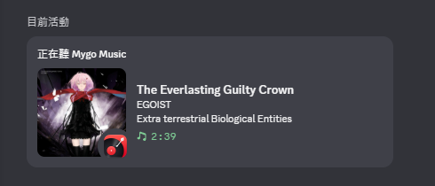

# MyGo Music Discord Presence

[简体中文](README.md) | [English](README.en.md)

An unofficial community plugin that reads the currently playing track from MyGo Music on Windows and shows it as Discord Rich Presence through the local Discord desktop client. It installs separately and does not replace or modify the NetEase Cloud Music plugin.

**Version:** 0.1.7 · **Platform:** Windows · **License:** AGPL-3.0-only

## Preview

## Features

- Shows the track title, artist, and playing or paused state.
- Tries to match album artwork from NetEase Cloud Music search results. Text presence still works when no cover is found.
- Shows the MyGo Music icon. If Discord rejects an image, the helper retries without the small image so the entire activity can remain visible.
- Reads playback information through Windows Media Session and communicates with the Discord desktop client through local RPC.

## Compatibility with MyGo source plugins

Presence sync reads MyGo's Windows Media Session and does not check or depend on a specific source plugin ID. Other MyGo source plugins should also work for text presence if they expose the playing track title and artist through the Windows media session. So far, the plugin has only been verified with [`sogud/mygo-music-netease`](https://github.com/sogud/mygo-music-netease); other sources have not been tested individually.

Album artwork lookup currently uses NetEase Cloud Music's public search endpoint, so cover matching is NetEase-specific. With other platforms, artwork may not be found or may match a different NetEase track with the same title. Text presence is unaffected when cover matching fails.
## Installation and setup

1. Install MyGo Music and the **Discord desktop client**. This plugin currently supports Windows only.
2. Create your own application in the [Discord Developer Portal](https://discord.com/developers/applications). Copy your **Application ID** from **General Information**.
3. In MyGo, open **Settings → Plugins → +** and install this plugin ZIP.
4. Open the plugin settings, enter your own Application ID, and allow the `powershell.exe` process permission. **Do not enter or share a Bot Token or Client Secret, and do not commit your personal Application ID to a public repository.**
5. Each time you start MyGo, open **Discord Status** once from the source menu in the top-left. After the helper starts, switch back to the NetEase Cloud Music source and play a track.
6. If Discord does not show the activity, make sure the Discord desktop client is running and check your Activity Privacy settings.

Each user should use their own Discord Application ID. The plugin does not bundle the maintainer's ID. Sharing developer credentials may conflict with Discord's Developer Terms. An Application ID alone does not work like a Bot Token, but it should still be handled according to Discord's terms.

## Privacy and data flow

- The plugin reads the track title, artist, album, playback state, and position from the Windows media session.
- To find album artwork, the helper sends the track title and artist to NetEase Cloud Music's public search endpoint at `music.163.com`. **It does not send NetEase cookies, account passwords, or audio.** This web search endpoint has not been confirmed as an officially authorized API for this project; see [Service and authorization](#service-and-authorization).
- Activity data is sent to the Discord desktop client over local IPC. It contains the title, artist, and image URLs. Discord may fetch the cover and MyGo icon URLs to display the images.
- Diagnostic logs are saved at `%LOCALAPPDATA%\MyGoMusic\DiscordPresence-addon.log`. They may contain the currently playing title and artist. Only the length of the Application ID is logged, not its full value. Check for personal track information before sharing logs.
- The plugin does not upload or save audio and does not sign in to a NetEase account.

## Service and authorization

The NetEase search endpoint used at runtime is a web endpoint, not an official Open Platform API confirmed as authorized for this project. It may change, rate-limit requests, or stop working. Public accessibility does not by itself grant authorization. Publishers and users remain responsible for complying with applicable NetEase Cloud Music terms. To reduce uncertainty, contact [NetEase's official developer and technical partnership channel](https://app.wyyunmusic.com/contact.html) about an official API and its permitted use.

This is an unofficial third-party plugin and is not affiliated with or endorsed by MyGo Music, Discord, or NetEase Cloud Music. The project does not distribute audio; rights to track information and cover art belong to their respective owners. See [`THIRD_PARTY_NOTICES.md`](THIRD_PARTY_NOTICES.md).

## Known limitations

- Windows and the Discord desktop client only.
- MyGo does not currently document a plugin startup hook, so you need to open the **Discord Status** page once after starting MyGo to launch the helper.
- Cover matching depends on NetEase search results and may fail or select a different recording. A failed cover lookup does not prevent text presence from being shown.
- MyGo ends the helper process when MyGo closes or the plugin is disabled.

## Troubleshooting

If the activity does not appear, make sure Discord desktop is running, reopen the **Discord Status** page, and inspect `%LOCALAPPDATA%\MyGoMusic\DiscordPresence-addon.log`. Before reporting an issue, include the relevant last lines and check them for private track information.

## Development note

This project was developed with AI coding assistance (often called “vibe coding”); OpenAI Codex contributed to writing and modifying most of the code and documentation. The maintainer guided the requirements, verified basic functionality in a real Windows/MyGo/Discord setup, and makes release decisions. Community review and feedback are welcome.

## License

The project source is licensed under the GNU Affero General Public License v3.0 only (AGPL-3.0-only). See [`LICENSE`](LICENSE) for the full text. Third-party content and rights notices are in [`THIRD_PARTY_NOTICES.md`](THIRD_PARTY_NOTICES.md).

