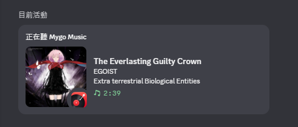

# MyGo Music Discord 状态显示

[简体中文](README.md) | [English](README.en.md)

MyGo Music 的非官方社区插件：在 Windows 上读取 MyGo 当前播放曲目，并通过本机 Discord 桌面客户端显示 Rich Presence。它作为独立插件安装，不会替换或修改网易云音乐插件。

**当前版本：0.1.7** · **平台：Windows** · **许可证：AGPL-3.0-only**

## 效果示范

## 功能

- 显示曲名、艺人和播放／暂停状态。
- 尝试从网易云公开搜索结果匹配专辑封面；未匹配时仍显示文字状态。
- 显示 MyGo Music 图标。Discord 拒绝图片时会移除小图后重试，避免整条活动状态消失。
- 通过 Windows Media Session 读取 MyGo 的播放信息；Discord 通信使用本机 RPC。

## 音源插件兼容性

状态同步读取 MyGo 的 Windows Media Session，不会检查或绑定某个音源插件 ID。因此，其他 MyGo 音源插件只要播放时能通过 Windows 媒体会话提供曲名和艺人信息，理论上也能显示文字状态。目前仅在 [`sogud/mygo-music-netease`](https://github.com/sogud/mygo-music-netease) 上完成实际验证，其他插件尚未逐一测试。

专辑封面查询目前固定使用网易云音乐公开搜索接口，因此这是网易云专用的封面匹配逻辑；使用其他平台时可能找不到封面，也可能匹配到网易云中的同名歌曲。封面不匹配不会影响文字状态。
## 安装和设置

1. 确保 MyGo Music 和 Discord **桌面客户端**已安装。此插件目前仅支持 Windows。
2. 在 [Discord Developer Portal](https://discord.com/developers/applications) 为自己创建一个应用，在 **General Information** 复制自己的 **Application ID**。
3. 在 MyGo 的“设置 → 插件 → +”中安装本插件 ZIP。
4. 打开插件设置，填入自己的 Application ID，并允许 `powershell.exe` 进程权限。**不要填写或分享 Bot Token、Client Secret，也不要把个人 Application ID 提交到公开仓库。**
5. 每次启动 MyGo 后，在左上角来源菜单中打开一次“Discord 状态同步”页面，看到已启动提示后切回网易云音乐来源并播放歌曲。
6. 若 Discord 没显示活动，检查 Discord 的“活动隐私”分享设置，以及 Discord 桌面客户端是否正在运行。

每位使用者都应使用自己的 Discord 应用 ID。插件不会捆绑作者的 ID。共用开发者凭据可能违反 Discord 开发者条款；Application ID 虽不像 Bot Token 那样能登录账号，仍应按 Discord 条款处理。

## 隐私和数据流

- 插件读取 Windows 媒体会话中的曲名、艺人、专辑、播放状态和进度。
- 为匹配专辑封面，辅助程序会把曲名与艺人名发送到 `music.163.com` 的公开搜索接口。**不发送网易云 Cookie、账号密码或音频内容。**该网页搜索接口并非本项目确认过的官方授权 API；请阅读下方“服务与授权”说明。
- Discord 活动内容通过 Discord 本机 IPC 发送给桌面客户端。活动包含曲名、艺人和图片 URL；Discord 可能访问封面 URL 与 MyGo 图标 URL 来显示图片。
- 诊断日志保存在 `%LOCALAPPDATA%\MyGoMusic\DiscordPresence-addon.log`。日志可能包含正在播放的曲名和艺人名；Application ID 仅记录长度，不记录完整值。分享日志前请检查并遮住个人信息。
- 不会上传或保存歌曲音频，也不会登录网易云账号。

## 服务与授权说明

网易云搜索接口属于运行时网页接口，不是此项目取得授权的官方开放平台接口。接口可能变更、限流或停止工作；公开可访问不等同于获得授权。发布者和使用者仍须遵守网易云音乐适用的服务条款。若要降低这项不确定性，可联系[网易云音乐官方开发者／技术合作渠道](https://app.wyyunmusic.com/contact.html)，询问正式 API 和授权方式。

本项目仅为 MyGo Music、Discord 和网易云音乐的非官方第三方插件，与这些项目或公司均无官方关联或背书。项目不分发歌曲音频；曲目信息和封面权利归各自权利人所有。详见 [`THIRD_PARTY_NOTICES.md`](THIRD_PARTY_NOTICES.md)。

## 已知限制

- 仅支持 Windows 和 Discord 桌面客户端。
- MyGo 目前没有文档化的插件启动钩子；因此每次启动 MyGo 后，需要打开一次“Discord 状态同步”页面来启动辅助进程。
- 封面匹配依赖网易云搜索结果，可能匹配不到或选错版本；封面搜索失败不会阻止文字状态显示。
- 关闭 MyGo 或停用插件后，MyGo 会结束插件启动的辅助进程。

## 诊断

如果状态没有出现，确认 Discord 桌面客户端正在运行，重新打开“Discord 状态同步”页面，并查看 `%LOCALAPPDATA%\MyGoMusic\DiscordPresence-addon.log`。报告问题时请附上末尾相关行，并先检查是否包含私人曲目信息。

## 开发说明

本项目采用 AI 辅助编程（vibe coding）方式开发，OpenAI Codex 参与了主要代码与文档的编写和修改。维护者负责需求方向、在实际 Windows／MyGo／Discord 环境验证基本功能及发布决定；欢迎社区审阅代码并反馈问题。
## 许可证

本项目源代码按 GNU Affero General Public License v3.0 only（AGPL-3.0-only）发布，完整文本见 [`LICENSE`](LICENSE)。第三方内容及其权利说明见 [`THIRD_PARTY_NOTICES.md`](THIRD_PARTY_NOTICES.md)。

